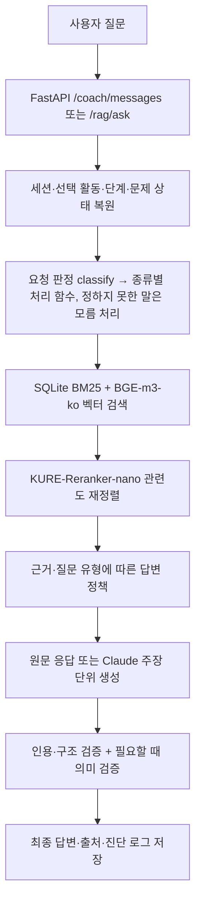
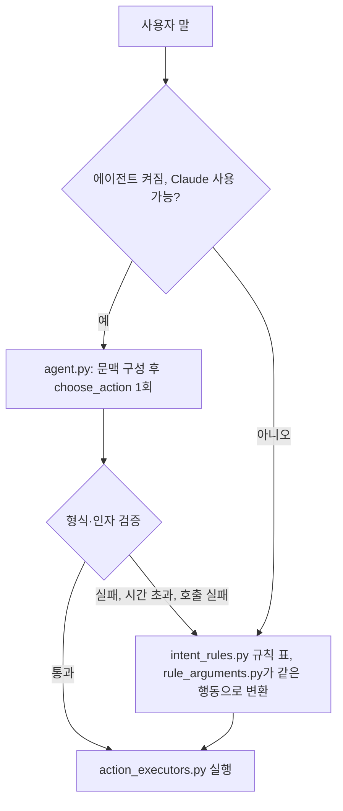

# 현재 챗봇과 V3 변화

## 사용자의 한 번의 질문이 지나가는 곳

여기서 에이전트는 별도 서버나 모델 한 개의 이름이 아닙니다. 한 문장은 먼저 `intent_rules.py`의 규칙 표(`classify`)로 요청 종류(선택·시작·완료, 준비물·단계·기록 조회, 추천, 문제 보고·질문, 인사 같은 안내)를 정합니다. `classify`는 세션·검색·모델을 건드리지 않고 판정 결과와 맞은 규칙 이름만 돌려주며, 이 값은 응답의 `diagnostics.intent_category`, `diagnostics.intent_rule`에 남습니다. 상태 변경·조회·추천 가운데 둘 이상에 걸리는 문장은 판정하지 않습니다. `coach.py`는 세션·잠금·재전송·예산·저장과 판정 결과를 `intent_handlers.py`의 처리 함수에 연결하는 일만 하고, 어느 규칙에도 맞지 않은 말은 모름 처리(`handle_unknown`)로 갑니다. 문제 보고·질문은 `dialogue.py`가 이어받고, 필요한 경우 `claude.py`를 통해 해석·계획·답변·검증 역할을 호출합니다. 값 추출(후보 번호, 단계 번호, 시간·도구 조건)은 `slots.py`, 취미별 낱말은 `vocabulary.py`에 있습니다. 요청마다 모든 역할을 호출하지 않으며 준비물·선택·기록처럼 정해진 처리는 LLM 없이 끝냅니다.

Claude와 검색 모델을 쓸 수 있는지에 따라 세 단계로 동작합니다(`service_level.py`).

| 단계 | 규칙이 정한 요청 | 정하지 못한 말 | 문제 보고 |
|---|---|---|---|
| Claude 사용 가능 | 처리 함수가 처리. 추천은 Claude 없이 검색 | Claude 해석에 맡김 | Claude 코칭(확인 질문, 근거 기반 답변) |
| Claude 없음(키 없음 또는 이번 턴 호출 실패), 검색 모델 정상 | 처리 함수가 같은 답을 냄. 호출 실패는 턴 실패가 아니라 이 단계로 내려감 | 재순위 점수가 기준(`rerank_min_score`)을 넘는 관련 자료가 있으면 읽기 전용으로 보여 주고(`evidence_lookup.py`), 없으면 되묻기. 후보 목록·문제 상태는 바꾸지 않음 | 보고를 기록하고 질문과 관련도가 높은 원문 항목만 추려 바로 안내 |
| Claude 없음, 검색 모델 고장(켜 두었는데 불러오지 못했거나 이번 검색에서 추론 실패) | 검색이 필요한 요청(추천, 원문 추리기가 필요한 설명·문제 보고, 관련 자료 조회)은 거절(`stop_reason=service_unavailable`)하고 세션 값을 바꾸지 않음. 선택·시작·완료·준비물·단계·인사처럼 검색이 필요 없는 요청은 그대로 처리 | 관련 자료 조회가 필요하면 거절, 주제가 없는 말은 되묻기 | 거절 |

설정으로 끈 검색 모델은 고장이 아니므로 키워드 검색으로 계속 동작합니다. Claude가 있을 때 검색 모델이 고장 나면 거절하지 않고 키워드 검색을 씁니다.

## 에이전트 진입점 (기본 꺼짐)

`COACH_AGENT_ENABLED=true`이고 Claude 키가 있으면, 규칙 표보다 먼저 Claude가 그 턴에 실행할 **행동 하나와 인자**를 고릅니다. 규칙 표는 Claude가 없거나 답하지 못할 때의 대체 경로가 됩니다. 기본값은 꺼짐이라 설정하지 않으면 위의 규칙 경로만 씁니다.

- **행동 목록**(`actions.py`): 후보 선택, 시작, 시작 거절, 완료, 확인 질문 답, 준비물·소요 시간·단계·기록 조회, 추천, 설명, 코칭, 안내, 되묻기의 14가지입니다. 에이전트는 사용자에게 보일 글을 쓰지 않고 행동만 고르며, 실행과 답 구성은 서버가 합니다.
- **같은 실행 함수**: 규칙 경로와 에이전트 경로가 `action_executors.py`의 같은 함수를 인자로 호출합니다. 처리 함수가 원문에서 뜻을 다시 판정하지 않습니다.
- **문맥**(`agent.build_context`): 대화 상태, 선택한 활동과 현재 단계·수행 상태, 직전 추천 후보(번호 포함), 대기 중인 확인 질문을 넘깁니다.
- **확인 질문**(`confirmation.py`): 에이전트가 켜져 있으면 완료는 "'○○' 활동을 완료로 기록할까요?"라고 물은 뒤 수락할 때만 기록합니다. 선택·시작은 서버 검증 뒤 바로 실행합니다. 꺼져 있으면 완료도 바로 기록합니다.
- **대체 경로**: 판단 호출은 `COACH_AGENT_TIMEOUT_SECONDS`(기본 10초) 안에 끝나야 합니다. 시간 초과, 호출 실패, 형식에 맞지 않는 판단, 쓸 수 없는 인자면 그 턴은 규칙 경로로 처리합니다. 알레르기 판정 요청은 에이전트에 넘기지 않습니다.
- **진단**: 응답의 `diagnostics.decided_by`(`agent` 또는 `rules`), `agent_action`, `agent_reason`에 누가 정했고 왜 규칙 경로로 내려갔는지 남습니다.
- **평가**: `scripts/evaluate_agent.py`가 기대 행동 자료(`data/agent_eval_labels.jsonl`)로 실제 Claude를 불러 일치율을 잽니다(유료 호출). `data/agent_eval_holdout.jsonl`은 아직 정답 확인을 거치지 않은 초안입니다.

## Spring 백엔드 연결

`backend_bridge.py`의 `POST /backend/coach/chat`은 Spring 백엔드가 서버 대 서버로 부르는 경로입니다. 백엔드의 대화 번호를 코치 세션에 잇고, 응답을 백엔드가 검증하는 모양으로 바꿉니다. 이 경로의 한 턴 제한은 백엔드의 대기 시간(45초)보다 짧은 40초(`COACH_BACKEND_TURN_SECONDS`)이고, 완료를 기록한 턴은 앱 화면에서 완료해야 앱의 활동 기록과 나무 성장에 반영된다고 답합니다. 계약은 [API 명세](HobbyTree_Coach_V3_API_Spec_ko.md) 11장에 있습니다.

활동·지식은 BM25와 임베딩 순위를 합친 뒤 리랭킹합니다. 2026-11-10부터 레시피도 별도 `recipes` 범위에서 BM25와 BGE-m3-ko 벡터 검색을 RRF로 결합하고 리랭커를 사용합니다. 전체 544,888건의 벡터를 배치 생성했으며, 검증된 세대만 로딩합니다. GPU/CPU dtype이 맞지 않거나 색인이 유효하지 않으면 레시피는 BM25로 돌아갑니다. 자세한 생성·재개·복구 방법은 [레시피 하이브리드 운영](RECIPE_HYBRID.md)을 참고하세요. 사용 중인 모델의 실제 이름·색인 수·준비 오류는 `/health`와 각 응답의 `diagnostics`에 표시됩니다.

## V2 대비 변화

| 항목 | V2 | 이번 V3 |
|---|---|---|
| 사용자 대화·검색 | 세션·검색·답변 검증 | 유지 |
| 전달 | 다른 날짜 폴더의 모델/환경에 의존 | 날짜 폴더 안의 모델·데이터·색인·Windows Python |

## 아직 남아 있는 한계와 개선 순서

1. **평가 기준부터 보강:** 원인 설명, 해결 방법, 절차 요약을 구분하는 사람이 검토한 정답·답변 가능성 자료가 필요합니다. 기존 holdout을 개발 과정에서 보았다면 새 holdout을 만들어야 합니다. 채점하지 않은 생성 결과나 예제의 성공률로 실제 효과를 주장할 수 없습니다.
2. **멀티턴 상태·라우팅 수정:** 이전 질문 의도가 이후 절차 설명을 막거나, 질문 문장이 실제 관찰처럼 저장되는지 재현 테스트를 먼저 추가합니다. 이런 문제는 상태 전이 코드 변경 요청으로 다루며 프롬프트만으로 해결됐다고 처리하지 않습니다.
3. **검색·근거 보강:** 현재 코칭 지식 486개는 모두 `source_only`입니다. 출처에 없는 원인·대처법은 생성만으로 사실이 되지 않습니다. 실제 실패 질문을 모아 전문가가 확인한 자료와 기대 근거를 보강합니다. 검색 누락과 답변 오류를 별도 측정합니다.
4. **일관성과 비용 조정:** 변경이 실제로 성능을 올리는지 반복 평가하고, 과도한 보류·치명 오류·지연·호출 증가를 함께 확인합니다. 작은 표본에서 차이가 불명확하면 결론을 보류합니다.

## NVIDIA Auto-Ontology와의 관계

현재 구현에는 Auto-Ontology를 추가하지 않았습니다. 향후 활동·도구·재료·증상·절차를 관계로 정리하거나 구조화된 레시피 테이블의 의미를 정의할 때 별도 후보로 검토할 수 있습니다. 온톨로지가 출처에 없는 조리 사실의 정확성을 보장하지는 않습니다.

참고: [NVIDIA Auto-Ontology 공식 저장소](https://github.com/NVIDIA/auto-ontology).
