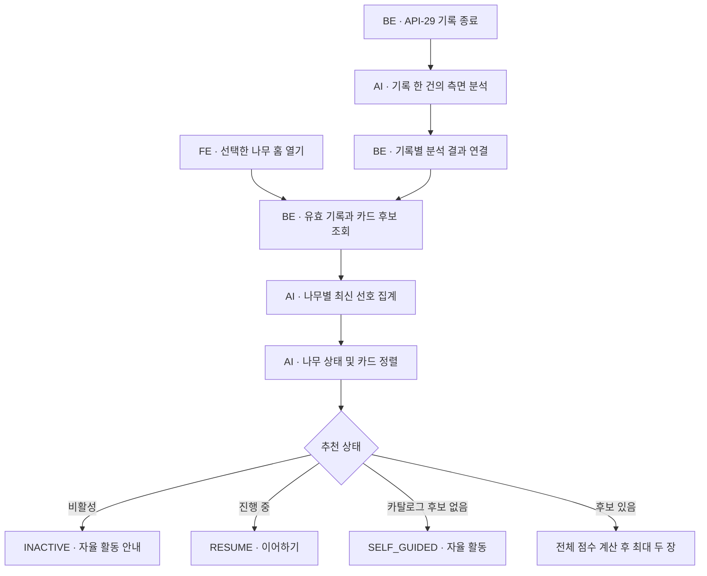

# HobbyTree 다음 활동 추천 API

한 사용자가 기록한 활동에서 **무엇이 좋았고, 무엇이 부담이었는지** 파악해 같은 취미 나무에서 실제로 시작할 수 있는 전체 후보를 평가한다. 홈에 보낼 때 최대 두 장으로 줄인다. 시작할 카드가 없으면 화면에서 바로 해볼 수 있는 무료 자율 활동을 제공한다. 측면 기반 감성 분석(ABSA, Aspect-Based Sentiment Analysis)을 한국어 표현 규칙으로 구현했다. 예컨대 한 기록에 ‘요리의 재미’와 ‘긴 소요 시간’이 함께 등장하면 각각 평가한다.

[OpenAPI 명세](docs/openapi.json)

## 한 문장에서 홈 카드까지

> 요리는 재미있었지만 시간이 너무 오래 걸렸어요. 다음에는 팬 하나로 끝나는 걸 하고 싶어요.

| 측면 | 해석 | 다음 카드에 반영하는 정보 |
|---|---|---|
| 즐거움 `ENJOYMENT` | 긍정 `POSITIVE` | 기록과 후보가 확인된 동일 활동 그룹이면 즐거움 평가를 최대 1점 반영한다. |
| 소요 시간 `DURATION` | 부정 `NEGATIVE` | 짧은 카드 우선 `PREFER_SHORTER` |
| 조리 방식 `COOKING_METHOD` | 긍정 `POSITIVE` | 원팬으로 확인된 카드 우선 `PREFER_ONE_PAN` |

시간 부담을 기록한 뒤 즐거움만 언급한 새 기록을 남기면 시간 선호는 유지된다. 시간에 관한 새 기록에서 시간 선호가 없다고 판정되면 과거 시간 신호를 해제한다. 사용자가 선택한 체감 난이도는 별도로 관리한다.



## 내부 API

모든 POST는 BE 전용 Bearer 토큰을 사용한다. 각 요청은 보내 준 데이터만 처리하며, 카드·분석 결과의 저장과 나무 소유권 검증은 BE가 담당한다.

| 메서드와 경로 | BE가 보내는 것 | 결과와 쓰임 |
|---|---|---|
| `POST /internal/v2/activity-feedback/analyze` | 종료한 한 기록. API-29의 `feedback` 안에 있는 만족도·체감 난이도·메모를 내부 요청의 최상위 필드로 옮긴다. | `recordId`, `reportedDifficulty`, `aspects`. 각 측면에는 범주·평가 방향·근거 구절·추천 신호가 담긴다. |
| `POST /internal/v3/activity-feedback/profile` | 해당 나무의 비삭제 기록, 시간대가 있는 종료 시각, 직접 선택한 난이도, 근거 원문을 제외한 측면 요약. 기록의 활동 그룹이 확인되면 `activityGroup`을 함께 전송한다. | `userHobbyId`, `recordCount`, `preferredDifficulty`, `signals`, `groupPreferences`. 뒤의 세 필드를 홈 정렬 요청에 매핑한다. |
| `POST /internal/v2/next-activities/rank` | 나무 상태·단계, 해금된 전체 후보, 완료 활동 ID, 프로필, 선택형 시간·예산. 후보에서 확인한 `activityGroup`을 전달할 수 있다. | `status`, `resumeRecordId`, `items`, `alternative`, `evaluatedCount`(실제로 점수를 계산한 후보 수), `priceFallback`(적합도 구간 내 낮은 가격순 적용 여부). 카탈로그 카드에는 점수, 선택 기준, 예상 비용, 예산 상태, 반복 여부가 있다. |
| 기존 `POST /internal/v2/activity-feedback/profile` | 활동 그룹을 제공하지 않는 기존 호출 | 기존 네 필드 응답을 사용한다. |
| 기존 `POST /internal/v1/next-activities/rank` | 기존 나무·후보 요청 | 동일 점수 정책을 기존 응답 구조로 반환한다. 활성 나무에 실제 카드가 없을 때 구버전은 `NO_MATCH`를 반환한다. 자율 활동은 v2 정렬 응답에 담긴다. |
| 기존 `POST /internal/v1/activity-feedback/analyze` | 기존 단일 기록 분석 호출 | `difficulty`, `sentiment`, `signals`, `evidence`, `recordId`. v3 프로필에는 v2 분석의 측면 요약을 사용한다. |
| `GET /healthz` | 인증 없이 상태 조회 | `{"status":"ok"}` |

분석의 입력 요건은 기록 종료 명세를 따른다. 완료·부분 수행은 만족도 1~5와 체감 난이도가 필요하고, 메모는 선택이다. 미수행은 사유가 필요하며 피드백 묶음을 함께 보내는 경우 점수와 난이도도 제공한다. 만족도는 필수값 검증에 쓰인다. 직접 응답이 없다면 v2의 `reportedDifficulty`는 null이다. HTTP 401은 내부 인증 문제, 422는 잘못된 요청이다. v2 정렬은 유효한 요청에서 시작 가능한 카탈로그 카드가 하나도 없으면 HTTP 200과 자율 활동을 제공한다.

합성 예제에서 후보 1004와 1005는 모두 20분이다. 최신 기록 401에서 얻은 시간 선호로는 두 카드를 구분할 수 없으므로 원팬 선호의 1점 차이로 카드 1005가 먼저 반환된다.

## 기록을 해석하는 기준

- **측면**은 즐거움, 난이도, 시간, 비용, 도구·정리 부담, 조리 방식 등 여섯 가지다. 한 측면에서 반대 의견이 함께 확인되면 `MIXED`, 규칙이 사실 언급만 확인하면 `NEUTRAL`이다. 인식한 내용이 없는 측면은 목록에서 생략한다.
- **근거**는 `source`(`memo` 또는 `notDoneReason`), 원문 조각 `text`, 0부터 시작하는 유니코드 코드 포인트 위치 `start`, `end`다. 시작 위치는 포함하고 끝 위치는 제외한다. 근거는 분석 결과를 검토할 때 사용하며 프로필·카드 요청에는 전달하지 않는다.
- **기록 집계**는 측면마다 가장 최근에 언급한 기록을 따른다. BE `finishedAt`에서 옮긴 시간대 포함 `completedAt` 순서로 비교하며 같은 시각이면 큰 `recordId`가 최신이다. 최신 관측의 `signal`이 null이면 과거 해당 신호를 해제한다. 언급하지 않은 측면은 과거 신호가 유지된다. v3은 즐거움·난이도 텍스트 관측을 (활동 그룹, 측면)별로 따로 집계한다. 최근 관측이 중립이나 혼합이면 해당 그룹 선호가 해제된다. 직접 선택한 체감 난이도에는 가장 최근의 비어 있지 않은 응답을 사용한다.
- **첫 방문·삭제**는 같은 방식으로 처리한다. 이력이 없으면 빈 배열을 전송한다. 삭제된 기록을 입력에서 제외해 집계를 다시 계산하면 이전 유효 기록이 최신 근거가 될 수 있다. 집계 요청에는 다른 나무의 기록이나 중복 기록 ID를 넣을 수 없다.

## 카드 선정과 데이터

1. 비활성 나무에는 `INACTIVE`와 나무 밖에서 해볼 자율 활동 안내를 반환한다. 활성 나무에 진행 기록이 있으면 `RESUME`과 해당 기록 ID를 반환한다.
2. BE가 모든 관련 단계와 페이지를 읽어 보낸 후보 중 같은 취미·공개·해금·시작 가능인 카드를 대상으로 한다. 미완료 카드가 하나라도 있으면 미완료 카드에서 고른다. 미완료가 전혀 없으면 완료 카드를 다시 할 수 있다. 반복 추천에는 `isRepeat: true`를 반환한다.
3. 단계, 시간, 예산, 피드백을 합산한다. 적합도는 백분율이나 성공 확률을 뜻하지 않는다.

| 구성 | 부여하는 점수 |
|---|---|
| 단계 | 현재 단계에서 72점, 단계가 하나 멀어질 때마다 9점 감소. 직접 선택한 난이도가 `HARD`이면 현재 단계와 바로 전 단계를 같은 최고 단계 점수로 취급한다. |
| 가용 시간 | 미설정 또는 시간 이내 16점, 설정했지만 예상 시간 미상 6점, 초과 0점 |
| 설정 예산 | 알려진 비용이 설정 예산 이내이면 2점. 예산 미설정·초과·가격 미상은 0점. 설정한 0원도 유효하다. |
| 즐거움·난이도 텍스트 | 각 측면당 동일 그룹 긍정 +1점, 부정 −1점, 적용할 근거 없음 0점 |
| 시간·비용·도구·조리 방식 | 각 최대 1점. 선호가 있으면 후보군에서 짧은 시간, 낮은 비용, 적은 도구를 상대적으로 우대한다. 원팬 선호는 확인된 원팬 카드에 반영한다. |

4. 75점 이상(`STANDARD`)을 먼저 채택하고 남은 표시 자리는 55점 이상(`RELAXED`), 0점 이상(`OPEN`)에서 채운다. 예산이 설정되어 있고 고려하는 후보 중 예산 이내로 확인된 카드가 하나도 없으면 **5점 적합도 구간**을 높은 순으로 비교한다. 같은 구간에서는 알려진 가격이 낮은 카드부터, 가격 미상은 뒤에 놓는다. 가격까지 같으면 세부 점수를 비교한다.
5. 표시 개수 `limit`은 1~2(기본 2)다. 후보가 한 장이면 한 장을 반환한다. 추천할 카탈로그 카드가 전혀 없으면 `SELF_GUIDED`와 자율 활동 제목·안내를 보낸다. 자율 활동은 준비물 구매나 서버 기록 생성이 필요 없다. 카탈로그 항목을 선택하면 API-26에서 시작 가능성을 다시 확인한다.

FE 카탈로그의 `level` 0~5를 집계하면 요리 150장, 악기 120장, 독서 72장, 커피 72장, 러닝 60장으로 총 474장이다. MVP 세 취미에는 342장이 있다. `level=6`은 이 집계에서 제외했다. 실제 홈 후보는 BE에서 공개·해금·시작 가능 검증을 통과한 카드다. 서버 숫자 ID와 API의 단계 번호 1~6을 사용한다. [카탈로그 기준 커밋](https://github.com/Kau-BugFree/hobby_tree_frontend/tree/6df22fae4d6882f8bd1ba7517d0a113fdfd8d88f/src/data/catalog)

AI 작업은 `develop`의 `521ffedd6b7ededfa6349a432aac410b94debb41`에서 분기했다. 기존 취미 추천(8000), 준비물 상품 추천(8001), 활동 코치(8003)와 별도 폴더·패키지·프로세스를 사용한다. 8010은 이 모듈의 로컬 실행 예시 포트다. [AI 소스 기준](https://github.com/Kau-BugFree/hobby-tree-AI/tree/521ffedd6b7ededfa6349a432aac410b94debb41/src)

## 로컬 실행과 검증

압축을 풀어 나온 `next-activity-recommender/` 폴더를 로컬 저장소의 `src/` 아래에 놓는다. 아래 명령은 저장소 루트에서 실행한다. Python 3.11 이상이 필요하다.

```bash
cd src/next-activity-recommender
python3.11 -m venv .venv
.venv/bin/python -m pip install -r requirements-dev.txt
.venv/bin/python -m pytest -q
export HOBBYTREE_NEXT_ACTIVITY_TOKEN="$(.venv/bin/python -c 'import secrets; print(secrets.token_urlsafe(32))')"
.venv/bin/python -m uvicorn next_activity.api:create_app --factory --host 127.0.0.1 --port 8010
```

서버와 같은 서비스 토큰을 가진 셸에서 아래 합성 예제를 각각 호출한다. 단건 분석은 시간·원팬을 언급한 메모를, 그룹 집계 예제는 그룹 반응을, 정렬 예제는 시간·원팬 선호를 설명한다. 실서비스에서는 BE가 해당 나무의 분석·집계 결과를 다음 요청에 연결한다. 호출 토큰은 공백 없는 출력 가능 ASCII 문자열 32자 이상이다.

```bash
base=http://127.0.0.1:8010
curl --fail-with-body -sS "$base/healthz"
curl --fail-with-body -sS "$base/internal/v2/activity-feedback/analyze" \
  -H "Authorization: Bearer $HOBBYTREE_NEXT_ACTIVITY_TOKEN" \
  -H 'Content-Type: application/json' --data-binary @examples/absa-feedback.json
curl --fail-with-body -sS "$base/internal/v3/activity-feedback/profile" \
  -H "Authorization: Bearer $HOBBYTREE_NEXT_ACTIVITY_TOKEN" \
  -H 'Content-Type: application/json' --data-binary @examples/group-profile.json
curl --fail-with-body -sS "$base/internal/v2/next-activities/rank" \
  -H "Authorization: Bearer $HOBBYTREE_NEXT_ACTIVITY_TOKEN" \
  -H 'Content-Type: application/json' --data-binary @examples/absa-rank.json
```

`examples/group-profile.json`에서는 동일 그룹 `ONE_PAN`의 즐거움 긍정과 난이도 부정이 한 점씩 반대 방향으로 작용해 해당 그룹 후보에서 상쇄된다.

예산 완화 경로는 정렬 입력 파일을 [fallback-rank.json](examples/fallback-rank.json)으로 바꾸어 확인한다. 예산 5,000원으로 평가한 네 후보 중 예산 이내 가격이 확인된 카드는 없다. 같은 단계에서 6,500원 카드 1004가 9,000원 카드 1005보다 앞서며, 가격 미상은 그 구간 뒤에 놓인다. 5,500원 카드 1007은 적합도 구간이 더 낮다. 응답은 `evaluatedCount=4`, `priceFallback=true`, 표시 순서 `[1004, 1005]`다. 서비스가 실행되면 `/docs`에서 요청을 보내거나 `/openapi.json`에서 계약을 확인할 수 있다. 한국어 표현 규칙의 실제 정확도는 파일럿 평가가 필요하다.
